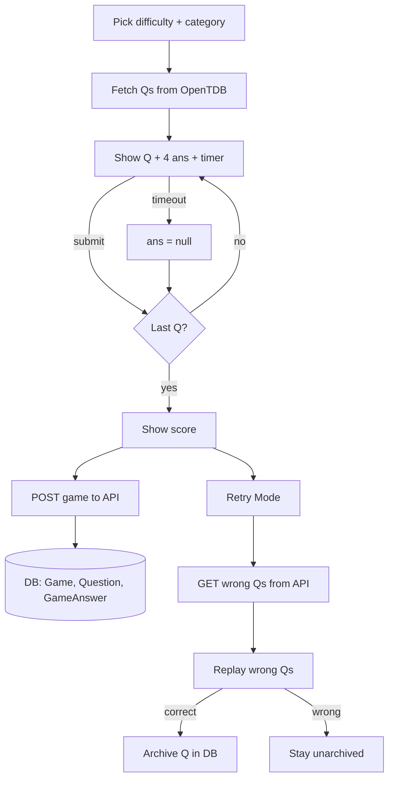
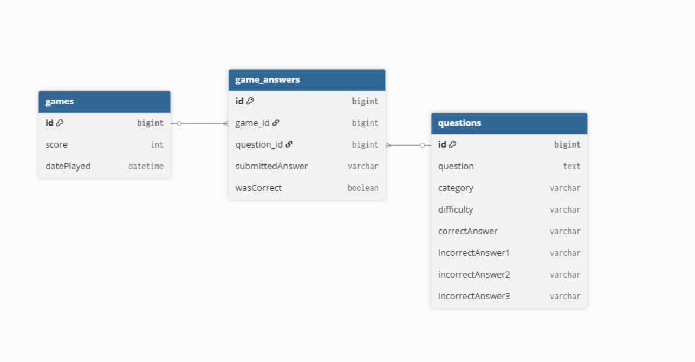
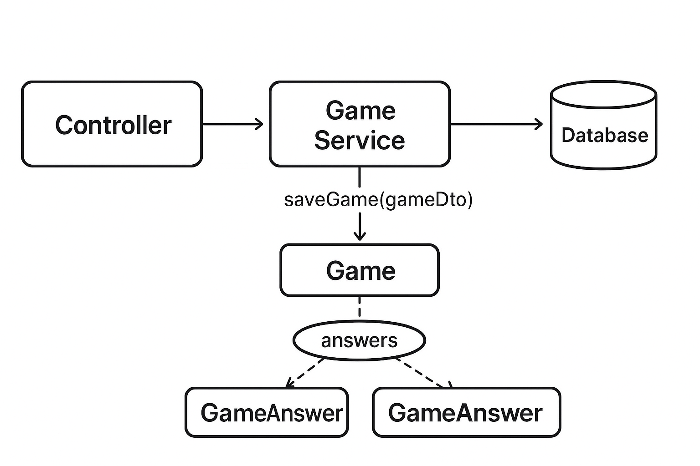

# Trivia Quiz Progress API + UI

## Introduction

Created a React UI and Spring Boot API that will allow users to keep track of the quiz games they played. The project was built to practise full-stack development and to learn how a React frontend, a Spring Boot API and a database fit together; key lessons were saving related records in the right order (Game, then Questions, then GameAnswers) and configuring CORS and API URLs across environments. Questions come from [Open Trivia Database API](https://opentdb.com/); game progress is saved to this backend.

## Features

### UI

- Pick difficulty and category, start game
- Question card, 4 answers, countdown timer
- Timeout → answer null, next question
- Last question → end game
- Score by difficulty: easy 10, medium 20, hard 30
- Retry button → replay wrong questions

### API

- Save game on finish: score, date, questions, submitted answer, correct answer, wasCorrect
- Fetch wrong questions (filter via query params)
- Retry correct → mark archived (original game data untouched)

### User Flow



### Data Flow

**Save game:** Frontend (GameResult) -> Backend (DB)

> GameResultDto → (1) saveGame → (2) saveQuestions → (3) saveAnswers

**Retry questions:** Backend (questions) -> Frontend (GameResult) -> Backend (DB)

- Fetch wrong Qs from past games, send to frontend as new game.
- Query params for custom filtering, eg. no. of Qs, type/category.

## Technologies

- Java
- Spring Boot
- Hibernate
- JPA
- React + TypeScript (frontend)

## Quick Start

### Backend (Spring Boot)

```bash
./mvnw clean install
./mvnw spring-boot:run -DskipTests
# API available at: http://localhost:8080
```

### Frontend (React)

```bash
cd frontend
npm install
npm run dev
# App available at: http://localhost:5173
```

## Database Design

Our Database requirements were:

1. A Game holds a list of GameAnswers.
2. A GameAnswer references both a Game and a Question.
3. A Question can be linked to multiple GameAnswers.



From the ERD diagram above:

> games ↔ game_answers: One-to-Many

- One Game has many GameAnswers.
- Each GameAnswer belongs to one Game.

> questions ↔ game_answers: One-to-Many

- One Question can appear in many GameAnswers.
- Each GameAnswer links to exactly one Question.

## Spring Architecture

### Game Service

GameService handles BOTH saving Game and Game Answers (via cascading).



The gameService needs to (in order!):

1. Save the Game record first (because GameAnswer needs its FK).
2. Ensure Questions exist (so GameAnswer can reference them).
3. Save each GameAnswer linked to both Game + Question.

### Question Service

Questions are handled by a separate QuestionService.

- `saveAll`: map QuestionDto → Question entity, save list. Three incorrect answers → three fields.
- Callers: GameService (save questions before answers), QuestionController (save + list endpoints).

## Project Links

- [nology project brief](https://github.com/nology-tech/aus-post-course-guide/tree/main/projects/trivia-api)
- [Group Trello Board](https://trello.com/b/14XGoYKh/trivia-full-stack-project-fred-carrie)
- [Figma Board](https://www.figma.com/board/p0I0y8Sr4brnA6b1FiPCDy/trivia?node-id=0-1&t=a3gPBNrj4if6PYC4-1)
- [Figma - visual interactive prototype](https://www.figma.com/proto/zPos2p8aVm7ntacLZgqYGO/trivia-mockups?page-id=0%3A1&node-id=55-1145&viewport=-762%2C-28%2C0.13&t=5Jyom8thV8RuHazm-1&scaling=scale-down&content-scaling=fixed&starting-point-node-id=55%3A1145&show-proto-sidebar=1)

<!-- ## Contact

This was a joint project between two developers, you can contact them here: -->

<!-- - add linked accounts here -->
